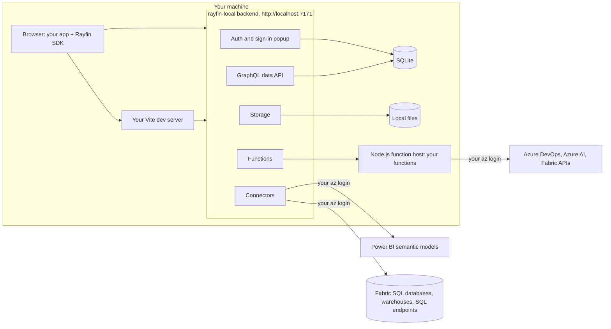

# rayfin-local

**Run a Rayfin app and its entire backend on your own machine, with nothing deployed to Fabric.**

[Rayfin](https://rayfin.ai) apps are TypeScript apps whose backend runs on Microsoft Fabric: database, data API, sign-in, functions, connectors and storage.
Even `rayfin dev` keeps that backend in Fabric, so before you can run anything you need a workspace, a capacity and a deployed app backend.

`rayfin-local` runs that backend locally instead.
It answers the same requests as the Fabric backend, so the Rayfin SDK 1.36 in your app can't tell the difference, and your code runs unchanged:

```sh
cd my-rayfin-app
npm install
rayfin-local serve
```

```text
  my-rayfin-app is running locally

  App         http://localhost:5173/
  Embedded    http://localhost:7171/.rayfin-local/portal/embed (the app inside a local Fabric frame)
  API         http://localhost:7171
  Entities    2 entities
  Functions   3 functions (askAnalyst, getBacklog, getModelRefreshStatus)
  Connectors  missioncontroltelemetry (fabric-semanticmodel, as you)
  Storage     off (services.storage is disabled in rayfin.yml)
  Data        C:\code\my-rayfin-app\.rayfin-local
  Sign in     Fabric sign-in opens a local page: create any account there, or continue as your Azure identity

  Press Ctrl+C to stop.
```

## Contents

- [Why use it](#why-use-it)
- [How it works](#how-it-works)
- [What works locally](#what-works-locally)
- [Install](#install)
- [Quick start](#quick-start)
- [Signing in](#signing-in)
- [Identity and Azure tokens](#identity-and-azure-tokens)
- [Secrets](#secrets)
- [Local state and reset](#local-state-and-reset)
- [Schema changes](#schema-changes)
- [Live reload](#live-reload)
- [Configuration file](#configuration-file)
- [Commands and flags](#commands-and-flags)
- [Troubleshooting](#troubleshooting)
- [More documentation](#more-documentation)

## Why use it

- **Start without Fabric.** Run a Rayfin app before you have a workspace, a capacity or a deployment.
- **Disposable data.** Each project gets its own SQLite database; start over with `--reset`.
- **A fast loop.** Entity changes migrate the database while the app runs, `rayfin.yml` changes apply without a restart, functions rebuild and reload, and Vite hot-reloads the UI.
- **Production code, unmodified.** Your app, the Rayfin SDK, your entity decorators and your functions run as they are; rayfin-local implements the backend side of the SDK's contract.
- **Real cloud data where you want it.** Functions and connectors call real Azure DevOps, Azure AI, Fabric and Power BI APIs and query real Fabric SQL databases, warehouses and Lakehouse SQL endpoints with your own Azure sign-in.
- **Easy end-to-end tests.** One command starts the whole app, and tokens can be fixed with environment variables.

rayfin-local is for local development and testing; deploy with `npx rayfin up` as usual.

## How it works



`rayfin-local serve`:

1. Reads `rayfin/rayfin.yml` and analyzes the entities in `rayfin/data` (and SQL connectors' entities in `rayfin/connectors`) with your project's own `@microsoft/rayfin-core`, as the Rayfin CLI does.
   A data package with `services.data.buildCommand` (a workspace layout with `services.data.path`) is built first, as the CLI does.
2. Creates or migrates a SQLite database in `.rayfin-local/`.
3. Starts one backend that answers every route the SDK calls: auth, `/graphql`, functions, connectors and storage, with your `@role` policies enforced.
4. Builds your functions and runs them on a Node.js host with the real `@microsoft/fabric-user-data-functions` package, without Azure Functions Core Tools.
5. Starts your app's own Vite dev server with environment variables that point the SDK at the local backend; your `.env` files are not changed.

[docs/architecture.md](docs/architecture.md) explains the design in depth.

## What works locally

| Rayfin feature | Locally | Notes |
| --- | --- | --- |
| Entities: queries, filters, sorting, pagination, relationships | Yes | DAB-compatible GraphQL over SQLite. |
| Entities: create, update, delete, aggregations | Yes | Each mutation runs in its own transaction. |
| `@role` permissions and row-level policies | Yes | Enforced in SQL, for every query and mutation. |
| Sign-up and sign-in with email and password | Yes | Local users. |
| "Sign in with Fabric" (`ensureSignedInWithFabric`) | Emulated | A local sign-in page: create an account, or continue as your Azure identity. |
| Embedded sign-in (`initEmbeddedAuth`) | Emulated | A local page plays the Fabric host: it frames the app and signs it in. |
| Automatic sign-in in development (`rayfinLocalDev({ autoLogin: true })`) | Emulated | Signs the app in as you, without an Entra prompt, or as a local user you choose. |
| Functions, `ctx.getDataClient()`, secrets | Yes | Rebuilt and reloaded when the sources change. |
| Function connections (`ctx.Tokens.ADO`, `.AzureAI`, `.Fabric`, `.Sql`, `.Storage`) | As you | Tokens for your own Azure account, not the app's identity. |
| `fabric-semanticmodel` connectors | As you | Real Power BI queries with your token. |
| SQL connectors (`fabric-sqldatabase`, `fabric-warehouse`, `fabric-sqlanalytics`) | As you | The real Fabric database, queried and written as you, with your entities' `@role` grants and policies; aggregations don't run yet. See [docs/sql-connectors.md](docs/sql-connectors.md). |
| Storage (`@blob` folders) | Yes | Files on disk, with the folders' rules. |
| Static hosting | Yes | `serve --static` builds the app once and serves it from the backend. |
| `kusto` connectors | No | They answer 501. |
| Passwordless sign-in, email verification, password-reset email | No | |
| GraphQL introspection | No | |

rayfin-local implements the contract of `@microsoft/rayfin-*` 1.36.x.
It is tested with the real 1.36.2 SDK, and end to end with real apps.
[docs/differences.md](docs/differences.md) lists every difference from Fabric.

## Install

**macOS and Linux:**

```sh
curl -fsSL https://raw.githubusercontent.com/spatney/rayfin-local/main/install.sh | sh
```

**Windows (PowerShell):**

```powershell
irm https://raw.githubusercontent.com/spatney/rayfin-local/main/install.ps1 | iex
```

The script downloads the latest [release](https://github.com/spatney/rayfin-local/releases) for your platform, checks it against the release's `SHA256SUMS.txt`, and installs the `rayfin-local` binary:

- **macOS and Linux:** into `~/.local/bin`. If that folder isn't on your `PATH`, the script prints the line to add to your shell's profile.
- **Windows:** into `%LOCALAPPDATA%\Programs\rayfin-local`, which it adds to your user `PATH`. Open a new terminal to pick it up there.

Then check it with `rayfin-local --version`.
Run the script again to update.
`RAYFIN_LOCAL_VERSION` installs a given version and `RAYFIN_LOCAL_INSTALL_DIR` picks another folder:

```sh
curl -fsSL https://raw.githubusercontent.com/spatney/rayfin-local/main/install.sh | RAYFIN_LOCAL_VERSION=0.1.0 sh
```

```powershell
$env:RAYFIN_LOCAL_VERSION = '0.1.0'; irm https://raw.githubusercontent.com/spatney/rayfin-local/main/install.ps1 | iex
```

| Platform | Release build |
| --- | --- |
| Windows x64 (and Windows on ARM, through emulation) | `x86_64-pc-windows-msvc` |
| macOS on Apple silicon or Intel | `aarch64-apple-darwin`, `x86_64-apple-darwin` |
| Linux x64 or ARM64 with glibc 2.34 or later (Ubuntu 22.04, Debian 12, Fedora 35, RHEL 9 or newer) | `x86_64-unknown-linux-gnu`, `aarch64-unknown-linux-gnu` |

Other ways to install:

- **Download** the archive for your platform from the [releases page](https://github.com/spatney/rayfin-local/releases), check it against `SHA256SUMS.txt` (`sha256sum -c --ignore-missing SHA256SUMS.txt`, or `Get-FileHash` in PowerShell), and put `rayfin-local` on your `PATH`.
  The macOS binaries are not notarized: if Gatekeeper blocks one you downloaded with a browser, run `xattr -d com.apple.quarantine rayfin-local`.
- **From source**, with [Rust](https://rustup.rs) 1.96 or later, for other platforms such as Alpine Linux:
  `cargo install --locked --git https://github.com/spatney/rayfin-local rayfin-local`.

To uninstall, delete the binary. On Windows, also remove `%LOCALAPPDATA%\Programs\rayfin-local` from your user `PATH`.

### Requirements

- **Node.js 20 or later** on `PATH` (or `RAYFIN_LOCAL_NODE` set to the `node` executable).
  rayfin-local runs your project's own packages with it: `@microsoft/rayfin-core`, `vite`, `typescript` and your functions.
- **Your project's npm packages:** run `npm install` in the project, and in `rayfin/functions` when it has its own `package.json`.
- **Optional: a signed-in Azure CLI (`az login`) or Rayfin CLI (`npx rayfin login`)**, for functions that use `ctx.Tokens`, for connectors, and for "Continue as" on the sign-in page.
  SQL connectors also need your account to have access to their Fabric items, and TCP port 1433 open to Fabric.

## Quick start

```sh
cd my-rayfin-app
npm install
rayfin-local doctor   # optional: checks Node.js, packages, Azure sign-in and ports
rayfin-local serve
```

Open the **App** URL from the banner and sign in (see [Signing in](#signing-in)).
Output from Vite, your functions and builds is prefixed with `[vite]`, `[fn]` and `[build]`.
Press Ctrl+C to stop everything.

Other ways to run it:

```sh
rayfin-local serve --static        # build the app once and serve it from the backend
rayfin-local serve --no-frontend   # only the backend, for your own dev server or tests
rayfin-local serve -C path/to/app  # a project other than the current directory
rayfin-local serve --reset         # start from an empty database
rayfin-local serve --json          # for programs: JSON events on stdout, stops when stdin closes
```

Programs that run rayfin-local for the developer, such as [Fabricator](https://github.com/spatney/rayfin-fabricator), use `serve --json`; [docs/embedding.md](docs/embedding.md) is their contract.

### The backend's routes

The backend has one origin, `http://localhost:7171` by default.
Its port is remembered per project; when it is busy, rayfin-local takes the next free one.

| Path | What it serves |
| --- | --- |
| `/rayfin.config.json` | The app's config: `apiUrl`, `publishableKey`, workspace, item and tenant ids, `portalUrl`. |
| `/api/auth/v1/*` | Auth: sign-up, sign-in, refresh tokens, sign-out. |
| `/.well-known/jwks.json` | The public keys that verify access tokens. |
| `/api/projectRuntimeSettings` | The auth settings from `rayfin.yml`. |
| `/graphql` | The data API. |
| `/functions/<name>/invoke` | Your functions. |
| `/connector-invoke/<name>` | Your semantic-model connectors. |
| `/connectors/<name>/graphql` | Your SQL connectors' entities. |
| `/api/storage/*` | Storage. |
| `/.rayfin-local/portal` | The local "Sign in with Fabric" page. |
| `/.rayfin-local/portal/embed` | The local Fabric host, for apps that sign in embedded. |
| `/.rayfin-local/health` | `{"ok":true}` once the backend is up. |
| `/.rayfin-local/dev/session-token`, `/.rayfin-local/dev/session-stamp` | Automatic sign-in, and the stamp of the sessions the backend accepts, for rayfin-local's own dev server only. |
| `/.rayfin-local/control/*` | The control API, for programs that run rayfin-local, with `RAYFIN_LOCAL_CONTROL_TOKEN` (see [docs/embedding.md](docs/embedding.md#control-api)). |

As on Fabric, `/api/*`, `/graphql`, `/functions/*`, `/connector-invoke/*` and `/connectors/*` need an `X-Publishable-Key` header; the local key is in `/rayfin.config.json`.

The app runs on its own Vite dev server, with your `vite.config` and plugins, on `RAYFIN_PUBLIC_FRONTEND_PORT` from `rayfin/.env` (default 5173).
rayfin-local starts Vite itself, never `npm run dev`, which may call `rayfin up` or `rayfin dev`.

## Signing in

Users are local: they live in `.rayfin-local/db.sqlite`, not in Entra ID.

- **Automatic sign-in.** Apps from Rayfin's templates sign themselves in during development (`rayfinLocalDev({ autoLogin: true })` in their Vite config).
  rayfin-local's dev server answers them itself, without opening any Entra sign-in, as the **sign-in identity** that `--sign-in-as` (or `[auth] sign_in_as` in `rayfin-local.toml`) sets:
  - `developer` (the default): you, as your own Entra user when `az login` or the Rayfin CLI's login has a token without a prompt and the backend listens on loopback, else a local account, `developer@example.com`.
  - `user:<username>`: that local user, created without a password when missing.
  - `none`: nobody, so the app offers its own sign-in, which opens the local sign-in page.

  Each page forgets the session the SDK stored for its origin when the backend no longer accepts it: another app's that ran on the same port, or one that `--reset` or a new sign-in identity signed out.
- **"Sign in with Fabric".** `ensureSignedInWithFabric` opens rayfin-local's sign-in page in the popup instead of the Fabric portal.
  There you can sign in with a local user, create one, or choose your own account, shown at the top with your name and email ("Continue as &lt;you&gt;"), to sign in as your own Entra user (the account of your `az` or Rayfin CLI login).
  "Continue as" is offered only when the backend listens on a loopback address.
- **Email and password.** The app's own sign-up and sign-in work as on Fabric.
  One local convenience: a password sign-in for an email that has no account creates the account (a wrong password for an existing account is still refused).
  Many app templates sign in to a local backend with a fixed development account (`MockAuthService`) and fall back to sign-up when it doesn't exist yet, a fallback the 1.36.2 SDK never reaches because `@microsoft/rayfin-client` exports a different `AuthError` class from the one it throws.
  Turn this off with `[auth] auto_create_users = false` in `rayfin-local.toml`.
- **Apps that sign in only inside Fabric** (`initEmbeddedAuth`, which does nothing outside a Fabric frame) need the **Embedded** URL from the banner, `http://localhost:7171/.rayfin-local/portal/embed`.
  That page plays Fabric's role: sign in there once, and it shows the app in a frame and signs it in, as Fabric does.
  Its bar has **Reload app** and **Switch user**.
- **The `email` claim** is set only when the username is an email address; "Continue as" sets it to your user principal name.
  Policies that compare `claims.email` need such a user.

`rayfin-local users` lists, adds and deletes local users and resets their passwords.

## Identity and Azure tokens

Deployed, functions get tokens for the app's identity, and connectors run as the app (`auth: application`) or as the signed-in user (`auth: delegated`).
Locally, all of them run as **you, the developer**:

- `ctx.Tokens.<Audience>` in functions (`Sql`, `Storage`, `Fabric`, `AzureAI`, `ADO`) holds a token for your account.
- `fabric-semanticmodel` connectors query Power BI with your token (the app user must still be signed in).
- SQL connectors find their Fabric item with your `Fabric` token and sign in to its database with your `Sql` token, even for `auth: application` connectors; your entities' `@role` grants and policies still apply to the app's signed-in user.

A function or query can therefore reach exactly what your account can reach.

`--token-source` (or `[tokens] source` in `rayfin-local.toml`) chooses where tokens come from:

| Source | Tokens from |
| --- | --- |
| `auto` (default) | The Azure CLI, then the Rayfin CLI's login. |
| `az` | `az account get-access-token --scope <scope>`: run `az login` first. |
| `rayfin` | The Rayfin CLI's login, through the project's `@microsoft/rayfin-cli/auth`: run `npx rayfin login` first. It may open a browser window to sign in. |

`RAYFIN_LOCAL_TOKEN_<AUDIENCE>` overrides every source for one audience: `SQL`, `STORAGE`, `FABRIC`, `AZUREAI`, `ADO` or `POWERBI`.
It is meant for tests and CI; the token is used as given.

Each audience has a default scope, which `[tokens.scopes]` in `rayfin-local.toml` can override:

| Audience | Default scope |
| --- | --- |
| `Sql` (functions, SQL connectors) | `https://database.windows.net/.default` |
| `Storage` | `https://storage.azure.com/.default` |
| `Fabric` (functions, finding SQL connectors' databases) | `https://api.fabric.microsoft.com/.default` |
| `AzureAI` | `https://ai.azure.com/.default` |
| `ADO` | `499b84ac-1321-427f-aa17-267ca6975798/.default` |
| `PowerBI` (connectors, "Continue as") | `https://analysis.windows.net/powerbi/api/.default` |

`--tenant` (or `[tokens] tenant`) picks the Entra tenant; the default is your login's.
rayfin-local caches tokens in memory and never logs them.

## Secrets

Functions read the secrets declared in `rayfin.yml` as `ctx.Secrets.<NAME>`.
Locally, a secret's value comes from the environment, from `.rayfin-local/secrets.json`, or from the `Values` of `rayfin/functions/local.settings.json`, in that order.
`rayfin-local secret set`, `secret list` and `secret delete` manage `.rayfin-local/secrets.json`, which is never committed.
A running `serve` picks up a changed value there or in `local.settings.json` by itself, and restarts only its function host with it.

## Local state and reset

rayfin-local keeps its state in `.rayfin-local/` at the project root.
The folder has its own `.gitignore` (`*`), so none of it is committed.
Outside it, rayfin-local writes only build output: what your build commands produce (such as `dist/`) and the functions' `runtimemetadata.json`, which `rayfin dev` also generates.

| Path | Holds |
| --- | --- |
| `db.sqlite` | The app's data, users and sessions. |
| `keys/` | Token and storage signing keys. |
| `storage/` | Uploaded files. |
| `cache/` | Analysis output (the entities' and the SQL connectors'), where SQL connectors' databases are (`cache/connectors/`), and the helper scripts rayfin-local runs with Node.js. |
| `state.json` | The local app id, publishable key, workspace, item and tenant ids, and the last ports. |
| `secrets.json` | Local secret values. |
| `serve.lock`, `serve.json` | Keep a second `serve` (or a `reset`) off the project while one runs. |

- `rayfin-local serve --reset` starts from an empty database: it deletes `db.sqlite` (data, users and sessions) and `storage/`, and keeps the rest.
- `rayfin-local reset` deletes the whole folder after asking (`--yes` skips the question).

## Schema changes

Each time `serve` starts, and whenever an entity source changes while it runs (the files in `rayfin/data` and `rayfin/storage`, the files they import, and the tsconfig files), rayfin-local analyzes your entities and brings the SQLite tables up to date.

In a workspace layout, where `services.data.path` names a data package whose `package.json` `exports` (or `main`) the entities, the analysis imports the package's build output.
`serve` runs `services.data.buildCommand` in that package before it analyzes, at every start and whenever the sources of the package (or of the workspace packages its output imports) change, with the output prefixed with `[build]`; a failed build stops `serve`, or keeps the previous schema while it runs.
Rebuilding the package yourself also counts as a change.

- Changes that lose no data apply automatically: new entities, new optional fields, fields with a default, longer text, new indexes.
- Changes that would lose data are refused with a list of exactly what would be lost: dropped entities or fields that hold values, values that can't be converted to a new type, required fields without a default.
  Restart with `serve --force-schema` to apply them anyway (a `serve` started with it also applies them as you edit), or `serve --reset` to start over.

`rayfin-local schema` prints the app model and the SQLite schema derived from `rayfin/data`.

## Live reload

While `serve` runs, it applies these changes in place, on the same ports, so the app's URLs don't change:

| You change | What happens |
| --- | --- |
| The entities (`rayfin/data`, the files they import, the tsconfig files) | The database and the data API move to the new model (see [Schema changes](#schema-changes)). |
| `rayfin.yml`: `services` (`auth`, `data`, `functions`, `storage`), `connectors`, `secrets`, `name` | The services whose settings changed are rebuilt: turned on or off, or started again with the new settings. Users, sessions, data, signing keys and the sign-in identity stay. |
| The storage folders (`rayfin/storage`) | The storage service is rebuilt with the new folders. |
| The SQL connectors' entities (`rayfin/connectors/<name>/`, `metadata.json`) | They are analyzed again, and the connectors' routes rebuilt. |
| A secret's value (`secret set`, `secret delete`, `local.settings.json`) | Only the function host restarts, with the new values. |
| `rayfin-local.toml`: `[auth]`, `[fabric]`, `[connectors]`, `[functions]` | As for `rayfin.yml`. A new `[auth] sign_in_as` (unless you passed `--sign-in-as`) signs every session out, so the app signs in again as the new identity. |

`serve` prints what it applied, with the banner's rows that changed.
A `rayfin.yml` or `rayfin-local.toml` that can't be read is reported, and the previous configuration stays in use until it is fixed.
Programs that run rayfin-local can also apply all of these on request, with the control API's `POST /reload` (see [docs/embedding.md](docs/embedding.md#control-api)).

Some changes need a restart, and `serve` says so: moving the app's frontend (`services.staticHosting.path` or `root`, and with `--static` how it is built), and `[server]`, `[frontend]` and `[tokens]` in `rayfin-local.toml`.

When the Vite dev server stops by itself, `serve` starts it again on the same port, after 1, 2 and then 5 seconds.
After a fourth stop within two minutes it gives up and says so; the backend keeps running.

## Configuration file

An optional `rayfin-local.toml` at the project root holds rayfin-local's own settings.
Every key is optional, unknown keys are errors, and command-line flags win over the file.

```toml
[server]
port = 7171             # --port
host = "127.0.0.1"      # --host

[frontend]
port = 5175             # --frontend-port

[tokens]
source = "auto"         # --token-source: "auto" | "az" | "rayfin"
tenant = "contoso.onmicrosoft.com"   # --tenant

[tokens.scopes]         # audience = OAuth scope
AzureAI = "https://cognitiveservices.azure.com/.default"

[connectors]
powerbi_base_url = "https://api.powerbi.com"   # for mocks and sovereign clouds

[functions]
inspect_port = 9229     # --inspect

[auth]
auto_create_users = true   # a password sign-in to an unknown email creates the account
sign_in_as = "developer"   # --sign-in-as: "developer" | "none" | "user:<username>"

[fabric]
anonymous_data_access = true   # false: act like a tenant without anonymous data access
```

A port set by a flag or in this file must be free, or `serve` stops with an error; remembered and default ports move to the next free one.

Fabric accepts the `anonymous` role (`@anonymous()`, `@role('anonymous', ...)`) only when a tenant administrator turns on **Enable anonymous data access for Fabric Apps (Preview)**, which is off by default.
rayfin-local allows it and warns when your entities use it.
With `anonymous_data_access = false`, `serve` refuses such entities, as `rayfin up` does on a tenant without the setting, and answers requests without a token with Fabric's 401.

## Commands and flags

| Command | What it does |
| --- | --- |
| `rayfin-local serve` | Start the local backend and the app. |
| `rayfin-local doctor [--json]` | Check Node.js, installed packages, Azure and Rayfin sign-in, and ports. |
| `rayfin-local schema` | Print the app model and the SQLite schema derived from `rayfin/data`. |
| `rayfin-local reset [--yes]` | Delete `.rayfin-local/`: database, users, keys, stored files and secrets. |
| `rayfin-local users list\|add\|delete\|reset-password` | Manage local users. |
| `rayfin-local secret set\|list\|delete` | Manage local secret values (`.rayfin-local/secrets.json`); `secret list --json` prints them as JSON (never the values). |
| `rayfin-local version [--json]` | Print the version; with `--json`, also the version of the host contract and the Rayfin SDK versions it supports. |

`rayfin-local <command> --help` shows each command's arguments.
Every command takes these options:

| Option | Meaning |
| --- | --- |
| `-C, --project <DIR>` | The project to use. Default: the current directory, or the nearest parent with `rayfin/rayfin.yml`. |
| `-v, --verbose` | Show rayfin-local's debug logs. `RUST_LOG` replaces the default log filters. |

`serve` flags:

| Flag | Meaning |
| --- | --- |
| `--port <PORT>` | Backend port. Default: `[server] port`, else this project's last port, else 7171. |
| `--frontend-port <PORT>` | Vite port. Default: `[frontend] port`, else `RAYFIN_PUBLIC_FRONTEND_PORT` from `rayfin/.env`, else 5173. |
| `--static` | Build the app once and serve it from the backend instead of running Vite. |
| `--no-frontend` | Run only the backend. |
| `--no-functions` | Don't build or run the functions. |
| `--host <HOST>` | Interface to listen on. Default: `[server] host`, else `127.0.0.1`. **Anything but loopback exposes your Azure identity** to the network, through functions and connectors. With `0.0.0.0` or `::` the app's URLs still point at `localhost`, so to use the app from another device pass this machine's LAN address instead. |
| `--token-source <auto\|az\|rayfin>` | Where Azure tokens come from. Default: `[tokens] source`, else `auto`. |
| `--tenant <TENANT>` | Entra tenant for tokens. Default: your login's tenant. |
| `--sign-in-as <WHO>` | Who apps that sign in automatically sign in as: `developer` (you), `user:<username>` (a local user) or `none`. Default: `[auth] sign_in_as`, else `developer`. See [Signing in](#signing-in). |
| `--force-schema` | Apply schema changes that lose data. |
| `--reset` | Start from an empty database: delete the database and stored files (keeps ports, keys and secrets). |
| `--inspect[=PORT]` | Start the function host with the Node.js inspector, on port 9229 by default. |
| `--open` | Open the app in the browser once it is ready. |
| `--json` | For programs that run rayfin-local: events as JSON lines on stdout instead of the human output, and a graceful stop when stdin closes. [docs/embedding.md](docs/embedding.md) is the contract. |

### Environment variables

| Variable | Effect |
| --- | --- |
| `RAYFIN_LOCAL_NODE` | The `node` executable to use instead of the one on `PATH`. |
| `RAYFIN_LOCAL_TOKEN_<AUDIENCE>` | A fixed token for one audience (see [Identity and Azure tokens](#identity-and-azure-tokens)). |
| `RAYFIN_LOCAL_CONTROL_TOKEN` | Turns on the control API for programs that run rayfin-local; at least 32 characters (see [docs/embedding.md](docs/embedding.md#control-api)). |
| `RAYFIN_ENV_FILE` | The env file to read instead of `rayfin/.env`, as for the Rayfin CLI. |
| `RUST_LOG` | Log filters, such as `rl_graphql=debug`. |
| `NO_COLOR` | Turn off colored output. |

## Troubleshooting

Run `rayfin-local doctor` first: it checks what `serve` needs and says what to fix.

- **Windows: "Access is denied" when you run `rayfin-local`, or the installer warns that Windows refused to start it.**
  On managed devices, Microsoft Defender's attack surface reduction rules can block new, unsigned programs downloaded from the internet, depending on the program that starts them (in our tests: blocked from `cmd` and sometimes Windows PowerShell 5.1, allowed from PowerShell 7).
  Run it from PowerShell 7 (`pwsh`), or build it on your machine instead: `cargo install --locked --git https://github.com/spatney/rayfin-local rayfin-local`.

- **"Node.js was not found" or "Node.js … is too old".**
  Install Node.js 20 or later from <https://nodejs.org>, or set `RAYFIN_LOCAL_NODE` to a `node` executable.
- **"@microsoft/rayfin-core is not installed".**
  Run `npm install` in the project; rayfin-local uses the project's own packages.
- **"Port … is already in use".**
  A port you set with a flag or in `rayfin-local.toml` is taken: stop the program using it, or pick another port.
  Ports you didn't set move to the next free one by themselves.
- **Sign-in does nothing, or fails without a message.**
  Look at `serve`'s output for the failed request, and check that the app was opened from the **App** URL in the banner, not from an old dev server or a deployed URL.
- **"Couldn't sign you in automatically".**
  The sign-in identity is `none`, or signing in failed and the message says why.
  Sign in with the app's button, or restart with `--sign-in-as developer`.
- **Azure sign-in errors, or "No token available for audience …" from a function.**
  Run `az login` (with `--tenant <tenant>` for another tenant), or sign in with the Rayfin CLI (`npx rayfin login`) and use `--token-source rayfin`.
  A function still runs without a token; reading `ctx.Tokens.<Audience>` throws, and `serve` logs why the token is missing.
- **Consent errors (`AADSTS65001`).**
  The Azure CLI's app is not consented for that resource in your tenant.
  Use the Rayfin CLI's login (`--token-source rayfin`, or `source = "rayfin"` under `[tokens]`), or override the audience's scope under `[tokens.scopes]`.
- **"… is not the 1.36 SDK rayfin-local implements".**
  rayfin-local implements the wire contract of `@microsoft/rayfin-*` 1.36.x; with another version, behavior may differ from Fabric.
  Before 1.36, `@microsoft/rayfin-core` can't describe database policies to rayfin-local, so apps with `@role` policies fail to analyze: upgrade the app's `@microsoft/rayfin-*` packages to 1.36.
- **"Cannot find type definition file for …" (TS2688) when the entities are analyzed.**
  TypeScript also loads the `@types` packages in the `node_modules` of every parent folder; set `"types"` (or `"typeRoots"`) in `rayfin/tsconfig.json`, or remove the stray folder the message names.
- **"rayfin-local serve is already running this project".**
  Only one `serve` runs a project at a time; the message gives the other one's process id and URLs.
  Use it, or stop it (Ctrl+C in its terminal) and start again.
- **A schema change is refused.**
  The message lists the data the change would lose; restart with `--force-schema` to accept that, or `--reset` to start over.
- **The app says it must be opened in Fabric** (for example "Can't open this app outside Fabric").
  It signs in only inside a Fabric frame: open the banner's **Embedded** URL (`/.rayfin-local/portal/embed` on the backend) instead of the App URL.
- **"Continue as" (your own account) is missing from the sign-in page.**
  It needs a loopback `--host` and a token from `az login` or the Rayfin CLI's login.
- **A SQL connector's queries fail.**
  The error's message (also in `serve`'s output) says what to do: run `az login`, check `config.workspaceId` and `config.itemId` in `rayfin.yml`, ask the item's owner for access for your account (rayfin-local connects as you, even for `auth: application` connectors), or open TCP port 1433 to Fabric.
  `DatabaseOperationFailed` with an `extensions.detail` such as `Invalid column name …` means an entity file no longer matches its table: regenerate it from a fresh `metadata.json` (`rayfin connector remove`, then `connector add`).
  [docs/sql-connectors.md](docs/sql-connectors.md#when-it-fails) lists the failures.

## More documentation

- [Architecture](docs/architecture.md): how rayfin-local works, its design principles, crates and request flows.
- [SQL connectors](docs/sql-connectors.md): Category A connectors locally, their contract, schema, database and identity.
- [Differences from Fabric](docs/differences.md): what is supported, what differs and what is missing, per SDK surface.
- [Embedding](docs/embedding.md): the contract for programs that run rayfin-local, such as Fabricator: `serve --json` events, error codes, exit codes and the control API.
- [Development](docs/development.md): building, testing and releasing rayfin-local.

## License

[MIT](LICENSE).
