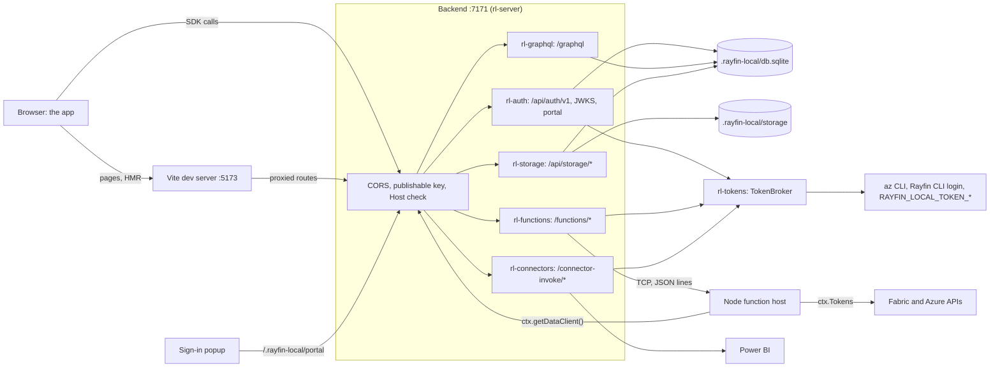
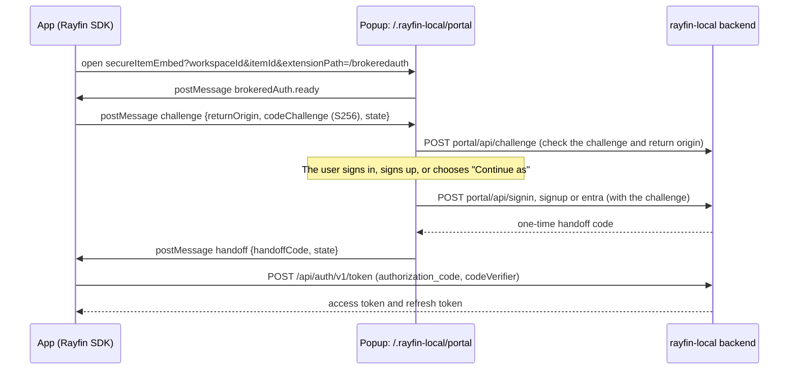
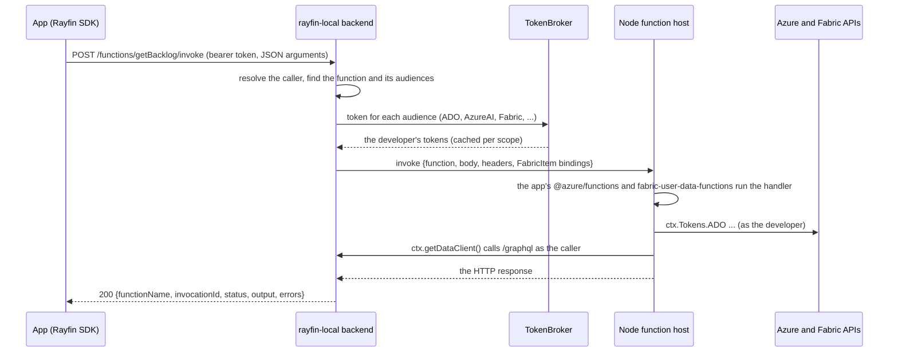

# Architecture

This document explains how rayfin-local works and why it is built the way it is.
The [README](../README.md) covers how to use it, and [differences.md](differences.md) covers how it differs from Fabric.

## Overview

A Rayfin app is a TypeScript frontend that uses the Rayfin SDK (`@microsoft/rayfin-*`) to talk to a backend in Microsoft Fabric.
That backend has an auth service, a database behind a DAB-style GraphQL API, user data functions, connectors to Fabric data, and blob storage.
The Rayfin CLI's `rayfin dev` runs the frontend and the functions locally but still needs that backend deployed in a Fabric workspace.

rayfin-local replaces the deployed backend with one local process.
It reads the same project files the Rayfin CLI reads (`rayfin/rayfin.yml`, the entities in `rayfin/data`, the functions package) and serves every HTTP route the SDK calls, with the behavior of the real services.
The app is unchanged: the SDK receives a different URL, and everything behind it is local.

### Goals

- **Unmodified apps.** Any Rayfin project on SDK 1.36.x runs with `rayfin-local serve`, without code or config changes.
- **Wire compatibility.** For every supported feature, the SDK sees the same status codes, headers, bodies and errors as from Fabric.
  The real SDK 1.36.2 is the oracle in tests.
- **No Fabric dependency** for the core services: auth, data, functions and storage run entirely on the machine.
- **Real data where needed.** Functions and semantic-model connectors reach real Azure and Fabric resources with the developer's own identity.
- **A fast inner loop.** Schema changes migrate the database live, functions rebuild and reload, and Vite hot-reloads the UI.
- **One binary.** `cargo install` (or a release download) is the whole installation; Node.js is the only other requirement, and every Rayfin project already needs it.

### Non-goals

- Hosting apps for other people: rayfin-local is a single-developer tool that listens on loopback.
- Emulating Fabric's capacity, throttling, quotas, networking or tenant administration.
- Exact SQL-dialect parity: SQLite stands in for Fabric SQL, and [differences.md](differences.md) lists where they differ.
- Emulating the app's managed identity: tokens are always the developer's.

## Design principles

1. **The SDK's wire contract is the specification.**
   rayfin-local implements what `@microsoft/rayfin-*` 1.36.x sends and expects, not the internals of the Fabric services.
   Where the SDK depends on a detail, such as 403 rather than 401 for a bad publishable key, or HTTP 200 envelopes for failed functions, rayfin-local reproduces it.
   The tests run the real SDK against rayfin-local.
2. **Run the project's own packages instead of reimplementing them.**
   Entity analysis uses the project's `@microsoft/rayfin-core`; functions run on its `@azure/functions` and `@microsoft/fabric-user-data-functions`; the frontend runs on its `vite` and `vite.config`; TypeScript compiles with its `typescript`.
   Small JavaScript helpers, embedded in the binary, drive these packages on the developer's Node.js.
   The behavior therefore follows the project's package versions, and decorator and policy semantics match the Rayfin CLI's exactly.
3. **Leave the project alone.**
   All state lives in `.rayfin-local/`, which carries its own `.gitignore`.
   Local settings reach Vite through the process environment rather than `.env` files.
   The only files written outside `.rayfin-local/` are build outputs the Rayfin CLI writes too: the app's build folder and the functions' `runtimemetadata.json`.
4. **Local and safe by default.**
   The backend listens on `127.0.0.1`, checks the `Host` header against DNS rebinding, and requires the publishable key, as Fabric does.
   Tokens and secret values are never logged.
   Because functions and connectors act with the developer's Azure identity, `serve` warns loudly when told to listen on anything but loopback.
5. **Independent feature crates.**
   Each service is a crate that returns an `axum::Router`.
   Feature crates see identity and tokens only through traits (`CallerResolver`, `TokenSource`), so each one is tested on its own with fakes.
6. **Fail loudly, with a fix.**
   Unsupported features answer explicitly (connector types the SDK can call but rayfin-local can't run answer 501 with guidance) instead of half-working.
   Unknown policy constructs are errors, not silently allowed.
   Errors say what to do: run `az login`, run `npm install`, restart with `--force-schema`.

## The big picture



## Repository layout

```text
crates/
  rayfin-local/    the binary: CLI, serve orchestration, live reload, the other commands
  rl-project/      project discovery, rayfin.yml, .env, package.json, rayfin-local.toml, .rayfin-local/
  rl-node/         Node.js discovery, embedded helpers, supervised process trees
  rl-model/        the app model built from @microsoft/rayfin-core's analysis; request identity
  rl-db/           SQLite, value codecs, entity DDL and migrations
  rl-graphql/      the DAB-compatible data API
  rl-auth/         auth routes, JWTs, the sign-in portal, the Entra exchange
  rl-tokens/       Azure tokens for the developer (az CLI, Rayfin CLI, env)
  rl-functions/    functions build, metadata, Node host and invoke routes
  rl-connectors/   /connector-invoke (semantic models)
  rl-storage/      /api/storage on local files
  rl-frontend/     Vite dev server and static builds
  rl-server/       router composition and the request guards
js/                helpers embedded in the binary and run with the project's Node.js
tests/fixtures/    a fixture Rayfin app and functions package used by the tests
tests/e2e/         Playwright tests: the fixture app and the explorer app in a browser
docs/              this document, differences.md, development.md, embedding.md
```

## Crates

| Crate | Role | Depends on |
| --- | --- | --- |
| `rayfin-local` | The binary: CLI (`clap`), `serve` orchestration and supervision, live reload, the host contract (`--json`), the other commands. | All the crates below. |
| `rl-project` | Project discovery; `rayfin.yml`, `rayfin/.env`, `package.json`, `rayfin-local.toml`; the `.rayfin-local/` state folder. | |
| `rl-node` | Node.js discovery, embedded JS helpers (`Helper`, `run_helper`), supervised process trees (`ManagedChild`). | |
| `rl-model` | The app model (IR) built from `@microsoft/rayfin-core`'s analysis; `Caller` and `CallerResolver` (request identity). | |
| `rl-db` | The SQLite handle (`Db`), value codecs, entity DDL and schema migrations. | `rl-model` |
| `rl-graphql` | `/graphql`: DAB-compatible queries, mutations, aggregations and policies, compiled to SQL. | `rl-model`, `rl-db` |
| `rl-auth` | `/api/auth/v1/*`, JWKS, runtime settings, the sign-in portal, the Entra exchange; implements `CallerResolver`. | `rl-model`, `rl-db`, `rl-tokens` |
| `rl-tokens` | `TokenSource` and `TokenBroker`: Azure tokens for the developer; `Audience` scopes. | `rl-node` |
| `rl-functions` | Functions build and watch, `runtimemetadata.json`, the Node function host, `/functions/<name>/invoke`. | `rl-model`, `rl-node`, `rl-tokens` |
| `rl-connectors` | `/connector-invoke/<name>`: `fabric-semanticmodel` through Power BI; 501 for other types. | `rl-model`, `rl-tokens` |
| `rl-storage` | `/api/storage/*` on the local file system, with `@blob` folder rules. | `rl-model`, `rl-db` |
| `rl-frontend` | The app's Vite dev server or static build, with the local Rayfin environment. | `rl-node` |
| `rl-server` | Router composition: `/rayfin.config.json`, CORS, publishable-key and Host checks, static hosting. | |

Two rules keep the feature crates independent of each other:

- Feature crates take `Arc<dyn rl_model::CallerResolver>` and `Arc<dyn rl_tokens::TokenSource>`, never the concrete auth or token types, so their tests use fakes.
- Each feature crate exposes an `axum::Router` with its state applied, and `rl-server` merges them.

## The life of `serve`

### Startup

1. Finds the project (`rayfin/rayfin.yml`) and opens `.rayfin-local/`, creating it on first use.
   `--reset` first deletes the database and stored files.
2. Finds Node.js 20 or later.
3. Analyzes `rayfin/data` and `rayfin/storage` with the project's `@microsoft/rayfin-core` (`js/analyze.mjs`), as `rayfin dev db apply` does.
   The result is cached in `.rayfin-local/cache/analysis.json` while its inputs are unchanged.
4. Opens `.rayfin-local/db.sqlite` and migrates the entity tables to the model.
5. Creates the token broker and the auth service.
6. Binds the backend port and chooses the frontend port.
   Ports set by a flag or `rayfin-local.toml` must be free; remembered and default ports move to the next free one.
7. Builds the router, starts the functions and the frontend, waits for the backend's health route, and prints the banner.

### While running

- **Entity changes.** A watcher on `rayfin/data`, `rayfin/storage` and `rayfin.yml` waits for edits to settle (500 ms), then analyzes again, migrates the database, and switches the data API to the new model without a restart.
  A failed analysis, or a change that would lose data, keeps the previous model and says why.
  Changes to `rayfin.yml` and to the storage folders need a restart, and `serve` says so.
- **Function changes.** The functions package's `build:watch` script (or the build command, when it has none) rebuilds it; the host restarts when the compiled output changes.
- **Frontend changes.** Vite's hot module replacement, as usual.

### Shutdown

Ctrl+C stops the server, then every child process tree (Vite, the function host, watchers).
A second Ctrl+C exits at once.
With `--json`, the end of stdin stops `serve` the same way (see [Hosts](#hosts-serve---json)).

## Hosts (`serve --json`)

Programs such as Fabricator run `serve --json` as a child process; [embedding.md](embedding.md) is their contract, and its version is `events::CONTRACT_VERSION`.

- **Events.** `crates/rayfin-local/src/events.rs` defines every event and writes them to stdout, one JSON line each, under a lock and flushed; `stopped` is the last, and anything emitted after it is dropped.
  The same calls that print the human output emit events with `--json`: `ui::step`, `status`, `warn` and `error` become `log` events, tracing goes through `events::LogLayer`, and `ui::child_sink` turns child output into `log` events by label (`[vite]`, `[fn]`, `[build]`, ANSI codes stripped).
  The banner is replaced by `ready`; nothing else reaches stdout, and the human output is unchanged without `--json`.
- **Codes.** Warnings hosts act on go through `ui::warning` with a code (`sdk-unsupported`, `secret-missing`, …).
  Fatal errors are classified in `errors.rs`: an error tagged at the stage that failed (`errors::Coded`, which shows as the error it wraps), else the first error of a known type in the chain (`ProjectError`, `NodeError`, `SchemaError`, `FrontendError`, …), else `internal`.
- **Stopping.** A thread reads stdin until it ends (`shutdown::StopListener`); `serve` listens to it, and to Ctrl+C, from the start, so a host that gives up during a slow start stops it too.
- **Feature crates** report through hooks rather than knowing about events: `rl-functions` calls `FunctionsConfig::on_state` (building, ready, failed with the compiler's messages), the token sources handed to the services report the audiences without a token (`azure-sign-in`), and which connector types run locally is decided in one place, `integrations::connector_runs_locally`.
- **Live state.** `events::live()` keeps the last `ready`, `schema`, `functions` and `vite` events, with or without `--json`, for the control API's `GET /status`.

## Requests

`rl-server` puts these in front of every feature route:

- **CORS** for loopback origins on any port and the app's `allowedRedirectUris`, without credentials.
- **The publishable key:** `/api/*`, `/graphql`, `/functions/*`, `/connector-invoke/*` and `/connectors/*` need `X-Publishable-Key`.
  A missing or wrong key is 403, never 401, which would make the SDK refresh and then sign the user out.
  The JWKS, `/api/projectRuntimeSettings`, `/rayfin.config.json`, `/.rayfin-local/*` and static files are exempt.
- **The Host check** (DNS-rebinding protection): the `Host` header must name the listening host or a loopback name, unless the backend listens on a wildcard address such as `0.0.0.0`.
- A JSON 404 for unknown routes, and request logs at debug level, without headers or bodies (signed storage URLs are redacted).

### Request identity

`rl-auth` implements `CallerResolver`: it verifies the request's bearer token (an ES256 JWT it issued) and returns a `Caller` with its role (`anonymous` or `authenticated`) and claims.
The data API, storage, functions and connectors all identify the caller this way.

## Auth

- Users are local accounts with argon2id password hashes, in `db.sqlite`.
- Access tokens are ES256 JWTs shaped like the real service's, signed with keys in `.rayfin-local/keys/` and published at `/.well-known/jwks.json`.
- Sessions are refresh-token families: each refresh rotates the token, and sign-out ends the family.
- A password sign-in for an unknown email creates the account when sign-up is allowed (`[auth] auto_create_users`, on by default), because the 1.36.2 SDK's `MockAuthService` pattern can't reach its sign-up fallback.
- "Continue as &lt;you&gt;" and the Entra exchange (`/api/auth/v1/brokered/token`) verify an Entra token against Microsoft's signing keys and sign in a local user keyed by the token's object id.
  "Continue as" uses the developer's own Power BI token from the token broker, and both are on only when the backend listens on loopback.

### "Sign in with Fabric"

The sign-in portal at `/.rayfin-local/portal` is the app's `fabricPortalUrl`, so `ensureSignedInWithFabric` opens it in its popup instead of the Fabric portal.
The page runs the same handshake as Fabric's brokered sign-in:



The return origin must be a loopback origin or one of the app's `allowedRedirectUris`.
Handoff codes are single-use and short-lived, and are bound to the PKCE challenge, the return origin and the user.
The SDK doesn't notice a popup closed by the user, so the page sends `access_denied` when it is cancelled or closed.

### Embedded sign-in

Apps that call `initEmbeddedAuth` sign in only inside a Fabric frame: Fabric loads them with `?fabricEmbedded=true` and answers their `fabric-auth` bridge requests.
`/.rayfin-local/portal/embed` plays that host.
The developer signs in on the host page first; the server then keeps a host session (a random token, stored hashed, in memory, for 12 hours), and the page frames the app.
Each `auth.requestHandoff` from the frame (a PKCE challenge, the app's origin and a state) is answered at once with a one-time handoff code for the host's user, which the app redeems at `/api/auth/v1/token` as in the popup flow.
Answering at once matters: the SDK gives the host 30 seconds, too little to wait for someone to type a password.
The page accepts messages only from the framed app's window and origin, the app's origin must pass the same check as a return origin, and its CSP allows only that origin in frames.

## Data

1. `js/analyze.mjs` compiles `rayfin/data` with the project's TypeScript and runs `@microsoft/rayfin-core`'s analyzer and DAB config generator.
2. `rl-model` turns that output (entities, the DAB config with its `x-schema`, policy ASTs, storage folders) into the app model.
3. `rl-db` derives the SQLite schema from the model, stores it, and migrates by diffing the stored schema against the new one.
   Additive steps run in place; other steps rebuild the table; steps that would lose data are refused unless forced.
   Losses are counted on the actual rows, inside the migration's transaction.
4. `rl-graphql` builds the schema DAB would generate, validates documents with Hot Chocolate's rules and messages, and compiles each root field into one parameterized SQL statement that builds its JSON.
   `@role` policies become SQL predicates with the caller's claims bound as parameters.

SQLite stores values the way the SDK observes them from Fabric SQL: case-insensitive text comparison (ASCII), lowercase UUID text with v4 defaults, fixed-width UTC timestamps, JSON booleans, and `@set` enums as `CHECK` constraints.
Decimals are stored as `REAL`, so they lose precision beyond about 15 significant digits.

## Frontend

### Dev mode (default)

`rl-frontend` runs `js/vite-dev.mjs` with the project's Node.js in the frontend folder (`services.staticHosting.path`, else the project root):

```text
node vite-dev.mjs --root <frontend dir> --host <host> --port <port> --backend <backend origin>
```

The helper starts the app's own `vite` package with its config and plugins, on exactly the chosen port, and adds one plugin, `rayfin-local:shim`:

- It always proxies `/.well-known/*` and `/.rayfin-local/*` to the backend.
- When the app's Vite config doesn't use `rayfinLocalDev()` (`@microsoft/rayfin-local-dev/vite`), it also does what that plugin does: it serves `/rayfin.config.json` with the dev server's origin as `apiUrl`, and proxies `/api`, `/graphql`, `/connector-invoke`, `/connectors` and `/functions` to the backend.

The local values reach the app through Vite's process environment, which beats the app's `.env` files in Vite's `loadEnv`; no file is written.
Each value is set under its `RAYFIN_PUBLIC_*` name, which `rayfinLocalDev()` reads, and its `VITE_*` name, which the app reads:

| Variables | Value |
| --- | --- |
| `RAYFIN_PUBLIC_API_URL`, `VITE_RAYFIN_API_URL`, `VITE_RAYFIN_BASE_URL` | The backend origin, such as `http://localhost:7171/`. |
| `RAYFIN_PUBLIC_PUBLISHABLE_KEY`, `VITE_RAYFIN_PUBLISHABLE_KEY` | The local publishable key (`pk-local-…`). |
| `RAYFIN_PUBLIC_FUNCTIONS_URL`, `VITE_RAYFIN_FUNCTIONS_URL` | `<backend>/.rayfin-local/functions`. |
| `RAYFIN_PUBLIC_PORTAL_URL`, `VITE_FABRIC_PORTAL_URL` | `<backend>/.rayfin-local/portal`, the sign-in page. |
| `RAYFIN_PUBLIC_WORKSPACE_ID`, `VITE_FABRIC_WORKSPACE_ID` | The workspace id from `rayfin/.env`, else a local one. |
| `RAYFIN_PUBLIC_ITEM_ID`, `VITE_FABRIC_ITEM_ID` | The item id from `rayfin/.env`, else a local one. |
| `RAYFIN_PUBLIC_TENANT_ID`, `VITE_FABRIC_TENANT_ID` | The tenant id from `rayfin/.env`, else empty. |
| `RAYFIN_PUBLIC_FRONTEND_PORT`, `VITE_PORT` | The dev server's port. |
| The project's other `RAYFIN_PUBLIC_*` values | Mapped as `rayfin env --framework vite` maps them (`RAYFIN_PUBLIC_FOO` → `VITE_RAYFIN_FOO`). |

`rayfinLocalDev()` rewrites `/functions/<name>/invoke` and `/.rayfin/api/<name>` to `<RAYFIN_PUBLIC_FUNCTIONS_URL>/api/<name>`, which the backend serves at `/.rayfin-local/functions/api/<name>`.

### Static mode (`--static`)

`rl-frontend` runs `services.staticHosting.buildCommand` (default `npm run build`) in the platform shell, in the frontend folder, with the same environment.
The output folder (`services.staticHosting.folder`) must then hold the index document (`indexDocument`, default `index.html`).
`rl-server` serves it from the backend origin with an SPA fallback, and `/rayfin.config.json` gives the backend origin as `apiUrl`, so the app and the API share one origin.

## Functions

`rl-functions` runs the app's functions package as the Azure Functions Node.js worker would, without Azure Functions Core Tools.

- **Build.** One build with `services.functions.buildCommand` (default `npm run build`) in the functions folder, then `npm run build:watch` when the package has that script, as `rayfin dev` does.
  Without `build:watch`, source changes rerun the build command.
- **Metadata.** `@microsoft/fabric-user-data-functions` registers functions from `runtimemetadata.json` in the package folder, which lists each `udf.func(...)` with its parameters and the audiences of its `RayfinContext` annotation.
  `js/udf-metadata.mjs` regenerates it with the package's own TypeScript type checker when the sources change, byte for byte as the Rayfin CLI writes it, and only writes it when its content changes.
- **Host.** `node function-host.mjs --entry <main>` runs in the functions folder, with the package's `local.settings.json` `Values` in its environment.
  It provides `@azure/functions-core`, the module the worker injects, then imports the package's entry point, so the app's own `@azure/functions` and `@microsoft/fabric-user-data-functions` register the functions.
  It announces `@@rayfin-local:ready {"port":N}` (or `load-error`) on stdout, and takes requests on `127.0.0.1:<port>`: one TCP connection per request, one JSON line each way (`describe`, `invoke`, `shutdown`), each carrying a per-process secret.
  `crates/rl-functions/src/host.rs` documents the protocol in full.
- **Environment.** `RAYFIN_API_URL` and `RAYFIN_PUBLISHABLE_KEY` point at rayfin-local, and `IsLocal` is `false`, so failed functions still answer HTTP 200 envelopes as deployed.
- **Supervision.** The host restarts when the compiled output changes; requests that arrive meanwhile get 503 with `Retry-After`.
  `--inspect[=PORT]` starts it with the Node.js inspector on `127.0.0.1`.

### An invocation



Each invocation runs through the library's own invocation model (`getArguments`, hooks, `invokeFunction`, `getResponse`), so the `HttpRequest`, the `InvocationContext` and the response come from the app's packages.
The host gets the caller's `Authorization` and `x-ms-rayfin-info` (the local backend's URL, the publishable key and the caller's token), so `ctx.getDataClient()` calls the local data API as the caller.
`x-ms-rayfin-secrets` carries the declared secrets.
For each audience the function declares, `rl-functions` mints a token from the `TokenSource` and passes it as the function's `FabricItem` input binding, which `ctx.Tokens.<Audience>` reads.
A missing token doesn't fail the invocation: reading that audience's token throws in the function, and `serve` logs why the token is missing.

## Connectors

`rl-connectors` looks up the connector in `rayfin.yml` and checks the operation is declared, in the deployed route's order.
For `fabric-semanticmodel`, it requires a signed-in caller, gets a Power BI token from the `TokenSource`, and sends the query to Power BI's `executeDaxQueries` the way the SDK's direct path does, streaming the Arrow answer back unchanged.
Power BI refuses `executeDaxQueries` to tokens without a dataset scope (Azure CLI tokens), so those queries go to `executeQueries` and come back in the JSON envelope the SDK also accepts.
Failures come back in the envelope the SDK's normalizer reads, so the app sees the same `QueryError`s as on Fabric.
Other connector types answer 501.

## Storage

`rl-storage` serves the routes of the 1.36.2 `StorageFolderClient` on files under `.rayfin-local/storage`, with the app's `@blob` folder rules.
Files are stored under random ids; their paths and metadata live in SQLite tables.
Uploads and downloads go through signed URLs under `/.rayfin-local/storage/`, whose HMAC token is the credential.

## Token broker

`rl-tokens`' `TokenBroker` implements `TokenSource`: a token for a scope, for the developer's identity.

1. `RAYFIN_LOCAL_TOKEN_<AUDIENCE>`, read at startup, wins for its audience.
2. Otherwise the mode (`--token-source`) picks the providers:
   - `az`: `az account get-access-token --scope <scope> [--tenant <tenant>]`.
   - `rayfin`: `js/rayfin-token.mjs`, which calls `getAuthenticatedToken` from the project's `@microsoft/rayfin-cli/auth`.
     It serves tokens from the Rayfin CLI's cache (`rayfin login`) and may sign in interactively, which the broker waits up to 180 seconds for.
   - `auto`: the Azure CLI, then the Rayfin CLI.

Tokens are cached per scope in memory and reused while they have more than 5 minutes left.
Concurrent requests for a scope share one fetch, and different scopes are fetched in parallel.
A request for an audience's default scope gets the audience's `[tokens.scopes]` override when there is one.
Failures carry a hint, such as running `az login` or switching the token source for a consent error.
The broker also reports whose tokens these are, from a Power BI token, for `rayfin-local doctor` and the sign-in page.

## Node helpers and processes

The JS helpers in `js/` are compiled into the binary (`include_str!`) and written to `.rayfin-local/cache/js/<name>-<hash>.mjs` before they run; see [`js/README.md`](../js/README.md).
They run on the developer's Node.js with the project folder as the working directory, so they use the project's own packages.
One-shot helpers (`analyze`, `udf-metadata`, `rayfin-token`) take a JSON input file and write a JSON output file (`run_helper`); long-running ones (`function-host`, `vite-dev`) announce readiness on stdout.

Child processes (Vite, the function host, builds and helpers) run in supervised process trees: a job object on Windows and a process group on Unix.
Stopping one asks it to close (Ctrl+Break or SIGTERM), then kills what is left of its tree after a few seconds.
A child that exits by itself releases its tree, so a browser it opened, for example for an interactive sign-in, stays open.
Their output goes to `serve`'s output, prefixed with a label such as `[vite]`, `[fn]` or `[build]` (with `--json`, as `log` events).

## Security model

rayfin-local is a development tool for one person, but it holds the keys to that person's Azure identity, so it is careful about who can reach it:

- **Loopback by default.** The backend, the function host and the Vite dev server listen on `127.0.0.1`.
  `--host` with another address prints a warning: anyone who can reach the backend and sign up can run the app's functions and connectors, which act as the developer.
- **DNS rebinding.** The `Host` check stops web pages on other origins from reaching the backend through a rebound DNS name; CORS only allows loopback origins and the app's `allowedRedirectUris`.
- **"Continue as"** signs in as the developer only when the request comes to a loopback host.
- **The sign-in page's endpoints** answer only the page itself: they need its CSRF token and an `Origin` equal to the portal's own.
- **The function host** listens on a random loopback port and refuses requests without its per-process secret.
- **Secrets and tokens** are never logged; request logs omit headers and bodies, and signed storage URLs are redacted.
  Helper results, which can carry access tokens, are deleted as soon as they are read (and on Unix live in a folder only the user can open).
- **State** in `.rayfin-local/` is ignored by git; it holds password hashes, signing keys and secret values.

## Extending rayfin-local

- **A new connector type.** Add a module to `rl-connectors` beside `semantic_model.rs` and dispatch to it on the connector's `type` in `invoke.rs`.
  Get tokens from the `TokenSource`, return failures in the shapes the SDK's normalizer reads, and update the support table in [differences.md](differences.md).
- **A new route.** Add it to the owning feature crate's router.
  Routes the SDK calls without a publishable key belong in that crate's exempt list (as `rl_auth::PUBLISHABLE_KEY_EXEMPT_PATHS` does for auth).
- **A new Node helper.** Add the script to `js/`, declare it with `rl_node::Helper::new(name, include_str!(...))` in the crate that uses it, and run it with `run_helper` (one-shot) or `ManagedChild` (long-running).
- **A new SDK version.** Compare its wire contract with 1.36.2 (routes, bodies, headers, error shapes), update the version check in `rl-project`, and run the conformance tests and the e2e suites with the new packages.
  The analysis runs the project's own `@microsoft/rayfin-core`, so changes to the analyzer's output show up as `rl-model` parse errors and in its golden tests.

## Testing

- **Unit and integration tests** in each crate (`cargo test --workspace`): the GraphQL compiler, policies, migrations, auth flows, storage and the token broker run against SQLite and fakes.
- **SDK conformance**: the `sdk.rs` tests of `rl-auth`, `rl-graphql` and `rl-storage`, `rl-connectors`' `sdk_decode.rs` and `rl-functions`' `host.rs` drive rayfin-local with the real `@microsoft/rayfin-*` 1.36.2 packages from the fixture app, and skip when Node.js or the packages are missing.
- **The host contract**: `crates/rayfin-local/tests/host_contract.rs` runs the built binary: `version --json`, fatal errors of `serve --json`, and a `serve --json` of the fixture app from its events to the end of stdin (it skips without the fixture's packages).
- **End to end**: Playwright drives the fixture app in `tests/e2e` (sign-in popup, data, functions, storage) and, optionally, the explorer app.

[development.md](development.md) has the commands.
