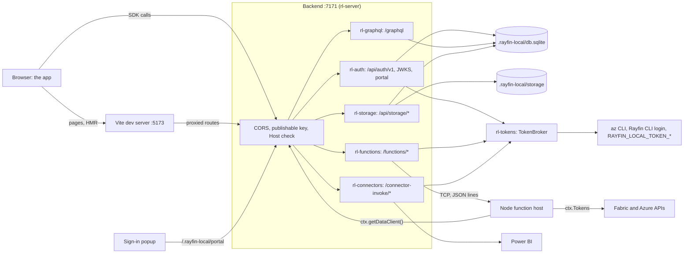

# Architecture

`rayfin-local` is one Rust binary built from a Cargo workspace, plus a few JavaScript helpers that it embeds and runs with the project's own Node.js.
`rayfin-local serve` reads a Rayfin project, starts one HTTP backend that stands in for every Rayfin service, and runs the app's own frontend against it.

## Crates

| Crate | Role | Depends on |
| --- | --- | --- |
| `rayfin-local` | The binary: CLI (`clap`), `serve` orchestration and supervision, the other commands. | All the crates below. |
| `rl-project` | Project discovery; `rayfin.yml`, `rayfin/.env`, `package.json`, `rayfin-local.toml`; the `.rayfin-local/` state folder. | |
| `rl-node` | Node.js discovery, embedded JS helpers (`Helper`, `run_helper`), supervised process trees (`ManagedChild`). | |
| `rl-model` | The app model (IR) built from `@microsoft/rayfin-core`'s analysis; `Caller` and `CallerResolver` (request identity). | |
| `rl-db` | The SQLite handle (`Db`), value codecs, entity DDL and schema migrations. | `rl-model` |
| `rl-graphql` | `/graphql`: DAB-compatible queries, mutations, aggregations and policies, compiled to SQL. | `rl-model`, `rl-db` |
| `rl-auth` | `/api/auth/v1/*`, JWKS, runtime settings, the sign-in portal, the Entra exchange; implements `CallerResolver`. | `rl-model`, `rl-db`, `rl-tokens` |
| `rl-tokens` | `TokenSource` and `TokenBroker`: Azure tokens for the developer; `Audience` scopes. | `rl-node` |
| `rl-functions` | Functions build and watch, `runtimemetadata.json`, the Node function host, `/functions/<name>/invoke`. | `rl-model`, `rl-node`, `rl-tokens` |
| `rl-connectors` | `/connector-invoke/<name>`: `fabric-semanticmodel` through Power BI; 501 for other types. | `rl-model`, `rl-tokens` |
| `rl-storage` | `/api/storage/*` on the local file system, with `@blob` folder rules. | `rl-model`, `rl-db` |
| `rl-frontend` | The app's Vite dev server or static build, with the local Rayfin environment. | `rl-node` |
| `rl-server` | Router composition: `/rayfin.config.json`, CORS, publishable-key and Host checks, static hosting. | |

Two rules keep the feature crates independent of each other:

- Feature crates take `Arc<dyn rl_model::CallerResolver>` and `Arc<dyn rl_tokens::TokenSource>`, never the concrete auth or token types, so their tests use fakes.
- Each feature crate exposes an `axum::Router` with its state applied, and `rl-server` merges them.

## What `serve` does

1. Finds the project (`rayfin/rayfin.yml`) and opens `.rayfin-local/`, creating it on first use (`--reset` first deletes the database and stored files).
2. Finds Node.js 20 or later.
3. Analyzes `rayfin/data` and `rayfin/storage` with the project's `@microsoft/rayfin-core` (`js/analyze.mjs`), as `rayfin dev db apply` does.
   The result is cached in `.rayfin-local/cache/analysis.json` while its inputs are unchanged.
4. Opens `.rayfin-local/db.sqlite` and migrates the entity tables to the model.
5. Creates the token broker and the auth service.
6. Binds the backend port and chooses the frontend port.
7. Builds the router, starts the functions and the frontend, and prints the banner.
8. On Ctrl+C, stops the server and every child process tree.

## Request flow



`rl-server` puts these in front of every feature route:

- **CORS** for loopback origins on any port and the app's `allowedRedirectUris`, without credentials.
- **The publishable key:** `/api/*`, `/graphql`, `/functions/*`, `/connector-invoke/*` and `/connectors/*` need `X-Publishable-Key`.
  A missing or wrong key is 403, never 401, which would make the SDK refresh and then sign the user out.
  The JWKS, `/rayfin.config.json`, `/.rayfin-local/*` and static files are exempt.
- **The Host check** (DNS-rebinding protection): the `Host` header must name the listening host or a loopback name, unless the backend listens on a wildcard address such as `0.0.0.0`.
- A JSON 404 for unknown routes, and request logs at debug level, without headers or bodies.

### Request identity

`rl-auth` implements `CallerResolver`: it verifies the request's bearer token (an ES256 JWT it issued) and returns a `Caller` with its role (`anonymous` or `authenticated`) and claims.
The data API, storage, functions and connectors all identify the caller this way.

## Auth

- Users are local accounts with argon2id password hashes, in `db.sqlite`.
- Access tokens are ES256 JWTs shaped like the real service's, signed with keys in `.rayfin-local/keys/` and published at `/.well-known/jwks.json`.
- Sessions are refresh-token families: each refresh rotates the token, and sign-out ends the family.
- The sign-in portal at `/.rayfin-local/portal` is the app's `fabricPortalUrl`, so `ensureSignedInWithFabric` opens it in its popup.
  The page runs the SDK's handshake: `brokeredAuth.ready`, then the app's PKCE challenge, then a one-time handoff code, which the app redeems at `/api/auth/v1/token`.
- "Continue as &lt;you&gt;" and the Entra exchange (`/api/auth/v1/brokered/token`) verify an Entra token against Microsoft's signing keys and sign in a local user keyed by the token's object id.
  "Continue as" uses the developer's own Power BI token from the token broker, and both are on only when the backend listens on loopback.

## Data

1. `js/analyze.mjs` compiles `rayfin/data` with the project's TypeScript and runs `@microsoft/rayfin-core`'s analyzer and DAB config generator.
2. `rl-model` turns that output (entities, the DAB config with its `x-schema`, policy ASTs, storage folders) into the app model.
3. `rl-db` derives the SQLite schema from the model, stores it, and migrates by diffing the stored schema against the new one.
   Additive steps run in place; other steps rebuild the table; steps that would lose data are refused unless forced.
4. `rl-graphql` builds the schema DAB would generate, validates documents with Hot Chocolate's rules and messages, and compiles each root field into one parameterized SQL statement that builds its JSON.
   `@role` policies become SQL predicates with the caller's claims bound as parameters.

## Frontend

### Dev mode (default)

`rl-frontend` runs `js/vite-dev.mjs` with the project's Node.js in the frontend folder (`services.staticHosting.path`, else the project root):

```text
node vite-dev.mjs --root <frontend dir> --host <host> --port <port> --backend <backend origin>
```

The helper starts the app's own `vite` package with its config and plugins, on exactly the chosen port, and adds one plugin, `rayfin-local:shim`:

- It always proxies `/.well-known/*` and `/.rayfin-local/*` to the backend.
- When the app's Vite config doesn't use `rayfinLocalDev()` (`@microsoft/rayfin-local-dev/vite`), it also does what that plugin does: it serves `/rayfin.config.json` with the dev server's origin as `apiUrl`, and proxies `/api`, `/graphql`, `/connector-invoke`, `/connectors` and `/functions` to the backend.

The local values reach the app through Vite's process environment, which beats the app's `.env` files in Vite's `loadEnv`; no file is written.
Each value is set under its `RAYFIN_PUBLIC_*` name, which `rayfinLocalDev()` reads, and its `VITE_*` name, which the app reads:

| Variables | Value |
| --- | --- |
| `RAYFIN_PUBLIC_API_URL`, `VITE_RAYFIN_API_URL`, `VITE_RAYFIN_BASE_URL` | The backend origin, such as `http://localhost:7171/`. |
| `RAYFIN_PUBLIC_PUBLISHABLE_KEY`, `VITE_RAYFIN_PUBLISHABLE_KEY` | The local publishable key (`pk-local-…`). |
| `RAYFIN_PUBLIC_FUNCTIONS_URL`, `VITE_RAYFIN_FUNCTIONS_URL` | `<backend>/.rayfin-local/functions`. |
| `RAYFIN_PUBLIC_PORTAL_URL`, `VITE_FABRIC_PORTAL_URL` | `<backend>/.rayfin-local/portal`, the sign-in page. |
| `RAYFIN_PUBLIC_WORKSPACE_ID`, `VITE_FABRIC_WORKSPACE_ID` | The workspace id from `rayfin/.env`, else a local one. |
| `RAYFIN_PUBLIC_ITEM_ID`, `VITE_FABRIC_ITEM_ID` | The item id from `rayfin/.env`, else a local one. |
| `RAYFIN_PUBLIC_TENANT_ID`, `VITE_FABRIC_TENANT_ID` | The tenant id from `rayfin/.env`, else empty. |
| `RAYFIN_PUBLIC_FRONTEND_PORT`, `VITE_PORT` | The dev server's port. |
| The project's other `RAYFIN_PUBLIC_*` values | Mapped as `rayfin env --framework vite` maps them (`RAYFIN_PUBLIC_FOO` → `VITE_RAYFIN_FOO`). |

`rayfinLocalDev()` rewrites `/functions/<name>/invoke` and `/.rayfin/api/<name>` to `<RAYFIN_PUBLIC_FUNCTIONS_URL>/api/<name>`, which the backend serves at `/.rayfin-local/functions/api/<name>`.

### Static mode (`--static`)

`rl-frontend` runs `services.staticHosting.buildCommand` (default `npm run build`) in the platform shell, in the frontend folder, with the same environment.
The output folder (`services.staticHosting.folder`) must then hold the index document (`indexDocument`, default `index.html`).
`rl-server` serves it from the backend origin with an SPA fallback, and `/rayfin.config.json` gives the backend origin as `apiUrl`, so the app and the API share one origin.

## Functions

`rl-functions` runs the app's functions package as the Azure Functions Node.js worker would, without Azure Functions Core Tools.

- **Build.** One build with `services.functions.buildCommand` (default `npm run build`) in the functions folder, then `npm run build:watch` when the package has that script, as `rayfin dev` does.
  Without `build:watch`, source changes rerun the build command.
- **Metadata.** `@microsoft/fabric-user-data-functions` registers functions from `runtimemetadata.json` in the package folder, which lists each `udf.func(...)` with its parameters and the audiences of its `RayfinContext` annotation.
  `js/udf-metadata.mjs` regenerates it with the package's own TypeScript type checker when the sources change, byte for byte as the Rayfin CLI writes it, and only writes it when its content changes.
- **Host.** `node function-host.mjs --entry <main>` runs in the functions folder, with the package's `local.settings.json` `Values` in its environment.
  It provides `@azure/functions-core`, the module the worker injects, then imports the package's entry point, so the app's own `@azure/functions` and `@microsoft/fabric-user-data-functions` register the functions.
  It announces `@@rayfin-local:ready {"port":N}` (or `load-error`) on stdout, and takes requests on `127.0.0.1:<port>`: one TCP connection per request, one JSON line each way (`describe`, `invoke`, `shutdown`), each carrying a per-process secret.
  `crates/rl-functions/src/host.rs` documents the protocol in full.
- **Invocations.** Each runs through the library's own invocation model (`getArguments`, hooks, `invokeFunction`, `getResponse`), so the `HttpRequest`, the `InvocationContext` and the response come from the app's packages.
  The host gets the caller's `Authorization` and `x-ms-rayfin-info` (the local backend's URL, the publishable key and the caller's token), so `ctx.getDataClient()` calls the local data API as the caller.
  `x-ms-rayfin-secrets` carries the declared secrets.
  For each audience the function declares, `rl-functions` mints a token from the `TokenSource` and passes it as the function's `FabricItem` input binding, which `ctx.Tokens.<Audience>` reads.
- **Environment.** `RAYFIN_API_URL` and `RAYFIN_PUBLISHABLE_KEY` point at rayfin-local, and `IsLocal` is `false`, so failed functions still answer HTTP 200 envelopes as deployed.
- **Supervision.** The host restarts when the compiled output changes; requests that arrive meanwhile get 503 with `Retry-After`.
  `--inspect[=PORT]` starts it with the Node.js inspector on `127.0.0.1`.

## Connectors

`rl-connectors` looks up the connector in `rayfin.yml` and checks the operation is declared, in the deployed route's order.
For `fabric-semanticmodel`, it requires a signed-in caller, gets a Power BI token from the `TokenSource`, and sends the query to Power BI's `executeDaxQueries` the way the SDK's direct path does, streaming the Arrow answer back unchanged.
Power BI refuses `executeDaxQueries` to tokens without a dataset scope (Azure CLI tokens), so those queries go to `executeQueries` and come back in the JSON envelope the SDK also accepts.
Failures come back in the envelope the SDK's normalizer reads, so the app sees the same `QueryError`s as on Fabric.
Other connector types answer 501.

## Storage

`rl-storage` serves the routes of the 1.36.2 `StorageFolderClient` on files under `.rayfin-local/storage`, with the app's `@blob` folder rules.
Files are stored under random ids; their paths and metadata live in SQLite tables.
Uploads and downloads go through signed URLs under `/.rayfin-local/storage/`, whose HMAC token is the credential.

## Token broker

`rl-tokens`' `TokenBroker` implements `TokenSource`: a token for a scope, for the developer's identity.

1. `RAYFIN_LOCAL_TOKEN_<AUDIENCE>`, read at startup, wins for its audience.
2. Otherwise the mode (`--token-source`) picks the providers:
   - `az`: `az account get-access-token --scope <scope> [--tenant <tenant>]`.
   - `rayfin`: `js/rayfin-token.mjs`, which calls `getAuthenticatedToken` from the project's `@microsoft/rayfin-cli/auth`.
     It serves tokens from the Rayfin CLI's cache (`rayfin login`) and may sign in interactively, which the broker waits up to 180 seconds for.
   - `auto`: the Azure CLI, then the Rayfin CLI.

Tokens are cached per scope in memory and reused while they have more than 5 minutes left.
Concurrent requests for a scope share one fetch, and different scopes are fetched in parallel.
A request for an audience's default scope gets the audience's `[tokens.scopes]` override when there is one.
Failures carry a hint, such as running `az login` or switching the token source for a consent error.
The broker also reports whose tokens these are, from a Power BI token, for `rayfin-local doctor` and the sign-in page.

## Node helpers and processes

The JS helpers in `js/` are compiled into the binary and written to `.rayfin-local/cache/js/<name>-<hash>.mjs` before they run; see [`js/README.md`](../js/README.md).
They run on the developer's Node.js with the project folder as the working directory, so they use the project's own packages.

Child processes (Vite, the function host, builds and helpers) run in supervised process trees: a job object on Windows and a process group on Unix.
Stopping one asks it to close (Ctrl+Break or SIGTERM), then kills what is left of its tree after a few seconds.
Their output goes to `serve`'s output, prefixed with a label such as `[vite]`, `[fn]` or `[build]`.
